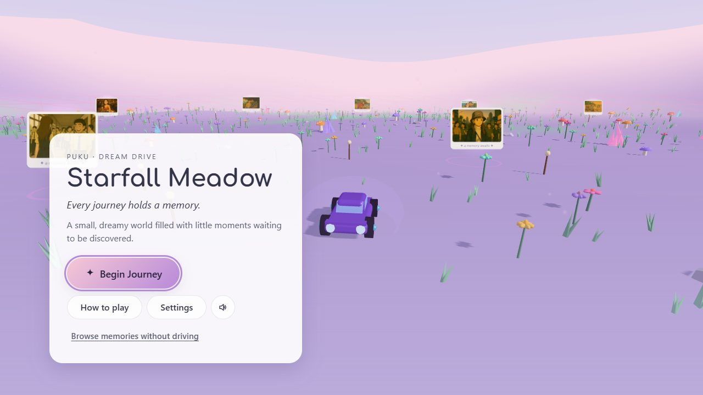
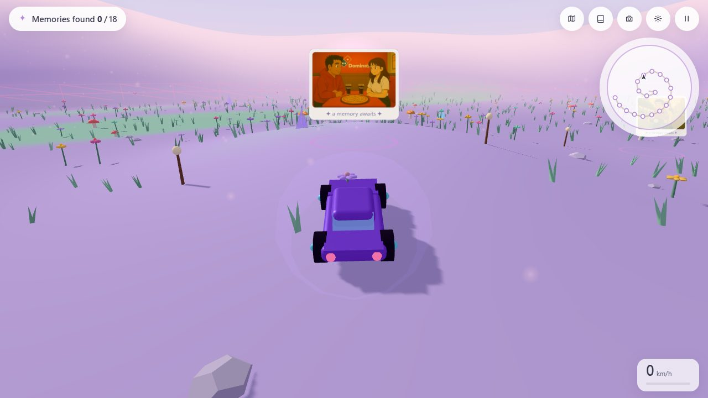
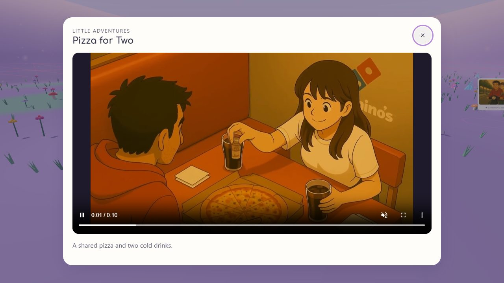
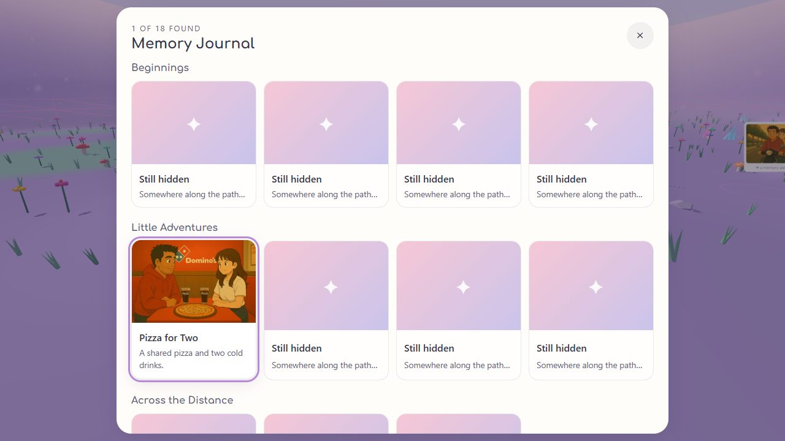
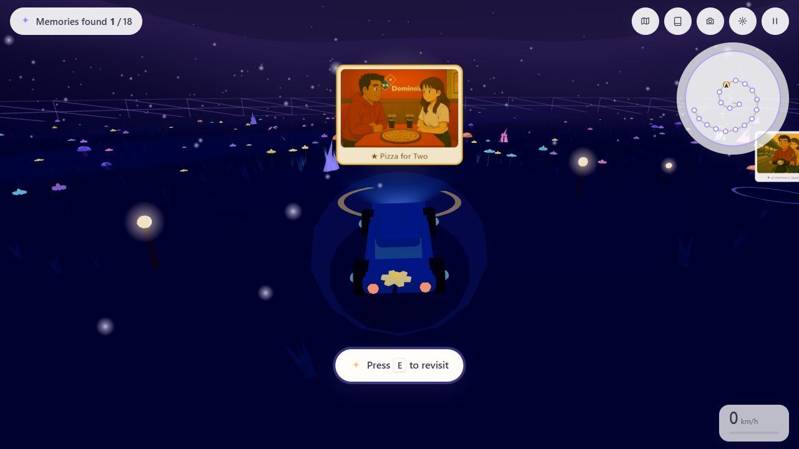
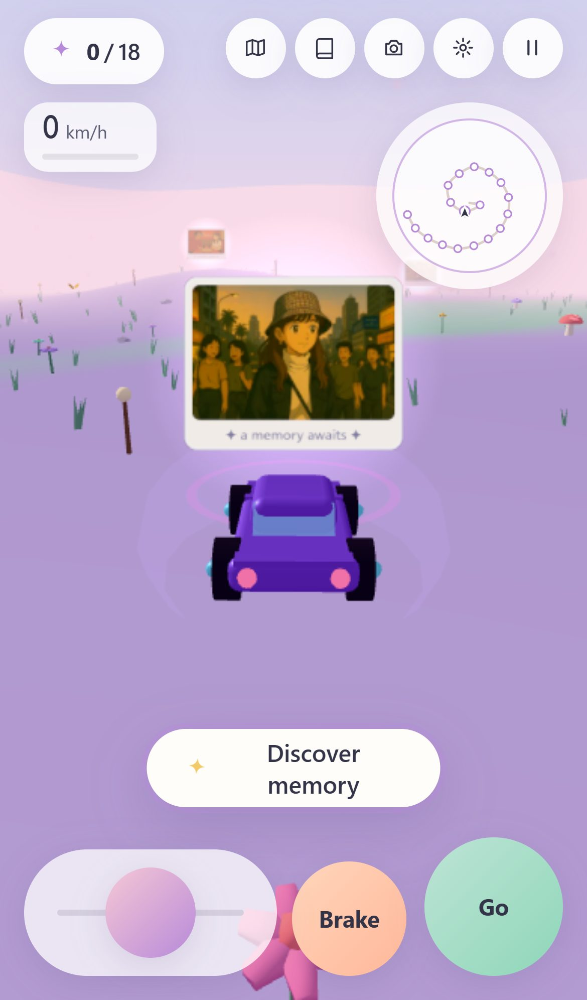

# PUKU — Starfall Meadow: Dream Drive

_Every journey holds a memory._

A tiny, dreamy 3D world that runs in your browser. Drive a little car through a pastel meadow, follow a soft winding path, and stop at floating picture cards to discover memories — illustrated moments with short videos. No install, no account, no backend.

**▶ Live: https://sudhanshumukherjeexx.github.io/puku/**



| Driving                                  | Discovering a memory                          | Memory journal                           |
| ---------------------------------------- | --------------------------------------------- | ---------------------------------------- |
|  |  |  |

| Cosmic Night theme                                          | Phone                                                                                        |
| ----------------------------------------------------------- | -------------------------------------------------------------------------------------------- |
|  |  |

## Features

- **18 memories** placed along a gentle spiral path in story order, each with an illustration and a short video
- **Memory journal** grouped by chapter, with hidden entries shown as silhouettes, plus a **gallery mode** to browse every memory without driving
- **Gentle milestones**: fireflies appear at 3 memories, a wishing tree grows at the heart of the meadow at 9, and stars fall when you find them all
- **Four themes** — Enchanted Dream, Sunset Oasis, Crystal Forest, Cosmic Night — that smoothly recolour sky, ground, lights, car, plants and HUD
- **Day/night cycle** (6 minutes) with stars, glowing flowers and path lanterns at night
- **Relaxed, frame-rate independent driving** with a smooth follow camera
- **Mini-map**, **photo mode** (orbit the car and save a PNG), **ambient soundscape** (generated live, no audio files)
- **Desktop, tablet and phone** support with touch controls, plus Low / Medium / High / Auto graphics presets
- **Accessible UI**: native modal dialogs, keyboard navigation, focus restoration, reduced-motion support

## Controls

| Keyboard        |                                 | Touch        |                                      |
| --------------- | ------------------------------- | ------------ | ------------------------------------ |
| `W` `↑`         | Accelerate                      | Left pad     | Slide to steer                       |
| `S` `↓`         | Brake, then reverse             | **Go**       | Hold to drive                        |
| `A` `D` `←` `→` | Steer                           | **Brake**    | Hold to brake / reverse              |
| `Space`         | Gentle brake                    | **Discover** | Appears near a memory                |
| `E` / `Enter`   | Discover nearby memory          | Toolbar      | Journal, map, photo, settings, pause |
| `J` · `T` · `P` | Journal · mini-map · photo mode |              |                                      |
| `H`             | Hide / show interface           |              |                                      |
| `Esc`           | Pause · close windows           |              |                                      |

## Run it locally

Requires Node.js 20+.

```bash
npm install
npm run dev        # http://localhost:5173
npm run build      # production build → dist/
npm run preview    # serve the build at http://localhost:4173
```

| Command                           | What it does                                                                                               |
| --------------------------------- | ---------------------------------------------------------------------------------------------------------- |
| `npm test`                        | Unit tests (Vitest, pure logic — no browser)                                                               |
| `npm run test:e2e`                | Browser tests (Playwright; builds and serves automatically)                                                |
| `npm run test:smoke`              | Only the essential `@smoke` browser tests                                                                  |
| `npm run lint` / `npm run format` | ESLint / Prettier                                                                                          |
| `npm run validate:memories`       | Validates the memory manifest and that every media file exists                                             |
| `npm run check`                   | Lint + unit tests + manifest validation + build                                                            |
| `npm run media`                   | Regenerates optimized media from `media/originals` (needs `ffmpeg`)                                        |
| `npm run bench`                   | Repeatable performance scenario against a running preview (see [docs/PERFORMANCE.md](docs/PERFORMANCE.md)) |

First-time browser tests: `npx playwright install chromium`.

## Deployment

Pushing to `main` runs [`.github/workflows/deploy.yml`](.github/workflows/deploy.yml): `npm ci` → lint → unit tests → manifest validation → build → deploy `dist/` to GitHub Pages. Browser tests run in a separate workflow so CI graphics quirks never block a release.

One-time setup: **Settings → Pages → Source: GitHub Actions**.

The build uses a relative base (`./`), so the same output works at `https://<user>.github.io/puku/`, at a domain root, or anywhere else static files are served. All media paths go through one helper ([`src/utils/assets.js`](src/utils/assets.js)).

## Customising the memories

Everything about the world's content lives in **[`src/content/world.json`](src/content/world.json)** — no code changes needed.

```jsonc
{
  "title": "Starfall Meadow",
  "tagline": "Every journey holds a memory.",
  "seed": 2025, // same seed → same world layout
  "defaultTheme": "enchanted-dream", // enchanted-dream | sunset-oasis | crystal-forest | cosmic-night
  "placement": { "mode": "spiral", "echoes": 0 },
  "memories": [
    {
      "id": "memory-01", // unique, lowercase-with-dashes
      "chapter": "Beginnings", // groups entries in the journal
      "title": "First Glances",
      "description": "School corridors, crisp uniforms, and the very first hellos.",
      "alt": "Illustration of two students meeting in a school corridor.",
      "image": "assets/memories/memory-01.webp",
      "thumbnail": "assets/memories/memory-01-thumb.webp",
      "video": "assets/memories/memory-01.mp4",
      "position": [40, -25], // optional [x, z]; otherwise placed automatically
    },
  ],
  "milestones": [{ "id": "fireflies", "at": 3, "effect": "fireflies", "title": "…", "message": "…" }],
}
```

To add a memory:

1. Put the original files in `media/originals/` as `imageN.png` / `videoN.mp4` and run `npm run media` (or add your own `.webp`/`.mp4` to `public/assets/memories/`).
2. Add an entry to `world.json`. Paths are **relative** (no leading `/`).
3. Run `npm run validate:memories` — it lists every problem (duplicate ids, missing files, bad paths) at once.

Optional fields: `poster` (defaults to `image`), `captions` (a `.vtt` file), `position`. Milestone `effect` can be `fireflies`, `landmark`, `finale` or `none`; `at` can be a number or `"all"`. `placement.echoes` adds extra markers that point at existing memories (they never inflate the found count).

## Architecture

Plain ES modules + [Three.js](https://threejs.org), bundled by Vite. No UI framework.

```text
src/
├── main.js                 boot, manifest validation, fatal-error fallback
├── content/world.json      memory manifest (the only place content lives)
├── core/                   Game (lifecycle + wiring), GameLoop (fixed 60 Hz step + rAF render),
│                           GameState (explicit state machine), Config, Settings, PerformanceManager
├── world/                  heightField (shared seeded terrain function), Terrain + path, Environment
│                           (sky shader, stars, 2 lights, fog), Decorations (instanced scenery),
│                           Effects (lanterns, milestones), ThemeManager + themes, DayNightCycle
├── vehicle/                CarPhysics (pure), Car (model), FollowCamera
├── memories/               MemoryManifest (validation), placement (seeded), Progress, ProximitySystem,
│                           MemoryManager (3D markers)
├── input/                  InputManager ← KeyboardController + TouchController
├── ui/                     HUD, Minimap (2D canvas), MemoryDialog, Journal, SettingsPanel, PhotoMode,
│                           LoadingScreen, Fallback, Diagnostics (lazy-loaded dev overlay)
├── audio/AudioManager.js   Web Audio soundscape
└── styles/                 design tokens + component CSS
```

Key rules: physics never touches the DOM; UI never touches physics; content only enters through the manifest; immutable config is separate from runtime state; the world is built once and only _mutated_ by themes, time of day and quality presets.

## Graphics settings & performance

| Preset | Pixel ratio | Shadows                 | Scenery density | Particles | Headlight |
| ------ | ----------- | ----------------------- | --------------- | --------- | --------- |
| Low    | 1           | off                     | 45%             | 120       | off       |
| Medium | ≤ 1.5       | 1024² (car & landmarks) | 75%             | 260       | on        |
| High   | ≤ 2         | 2048² (incl. scenery)   | 100%            | 450       | on        |

**Auto** picks a conservative preset from capability signals (touch/coarse pointer, screen size, CPU cores, device memory, GPU renderer string, texture limits) and steps down once if frame rate stays below ~38 FPS. It never steps back up by itself.

What keeps it light: repeated scenery is `InstancedMesh` (one draw call per kind); the car is merged geometry; only 2 lights plus one optional headlight; glow comes from emissive shader patches instead of point lights; rendering stops entirely while a dialog covers the world or the tab is hidden; thumbnails stream in after startup; videos load only when opened and are released on close. Measured numbers are in [docs/PERFORMANCE.md](docs/PERFORMANCE.md).

Developer diagnostics: add `?debug` to the URL (FPS, frame time, draw calls, triangles, textures, preset). The overlay is a separate lazy chunk that ordinary visitors never download.

## Browser support

Requires **WebGL 2**: current Chrome, Edge, Firefox and Safari (15+), on desktop, Android and iOS/iPadOS. Without WebGL 2 the page explains why and offers an HTML gallery of every memory instead of a blank screen.

## Accessibility

- Native `<dialog>` modals (focus containment, `Esc`), with focus returned to where you were
- Every control is a real `<button>` with a label; visible focus rings
- Respects `prefers-reduced-motion` (and a manual toggle): no bobbing, wind, camera shake or video autoplay
- Alt text for every memory image; videos have native controls and support optional captions (`captions` in the manifest)
- A "Browse memories without driving" gallery for anyone who can't or doesn't want to drive

Driving itself needs a keyboard or touch screen. The accessibility features above have been tested by hand and with automated browser tests, but not audited against WCAG, so no formal compliance is claimed.

## Privacy

- No analytics, tracking, cookies, accounts or third-party requests. Fonts are self-hosted.
- Local storage holds only preferences, plus found-memory ids if you turn on "Remember found memories" (off by default). **Settings → Clear saved data** removes everything.
- **Important:** everything in this repository and on its GitHub Pages site — including the photos and videos — is **publicly accessible**. Hiding a URL or obfuscating it does not make it private. If the memories should be private, they need access-controlled hosting instead of a public repo and Pages site.

## Media

Original illustrations and videos are preserved unchanged in `media/originals/` (Git LFS) and are **not** deployed. The site uses web-optimized copies in `public/assets/memories/` (WebP images: 1280 px viewer + 384 px thumbnails; H.264 ≤ 720p video with fast-start). That's about 20 MB in total, versus about 170 MB of originals, and only the ~260 KB of thumbnails load up front.

## Known limitations

- Driving needs a keyboard or touch screen; gamepads aren't supported yet.
- Graphics presets change density, shadows and pixel ratio instantly. Terrain resolution and anti-aliasing are chosen at startup, so a reload applies them.
- No collisions with scenery (by design — it's a relaxing drive); the world edge is a soft boundary.
- Photo export depends on the browser allowing downloads; some in-app browsers block it.
- Performance has been measured on one laptop with an Intel Iris Xe GPU, plus a software-rendering stress test. It has not yet been measured on real phones.

## Troubleshooting

- **"The meadow can't bloom here"** — WebGL 2 is off or unsupported. Update the browser or enable hardware acceleration.
- **Choppy on an older device** — Settings → Graphics → Low.
- **Blank page when opening `index.html` directly** — run `npm run dev` or `npm run preview`. ES modules need a web server.
- **Memory video won't play** — the viewer falls back to the illustration and says so. Check `npm run validate:memories`.

## Credits & license

Created by Sudhanshu Mukherjee. Originally built as [momomo](https://github.com/sudhanshumukherjeexx/momomo).
Code is released under the [MIT License](LICENSE). The memory illustrations and videos are personal content and are not covered by an open license unless the author says otherwise.
